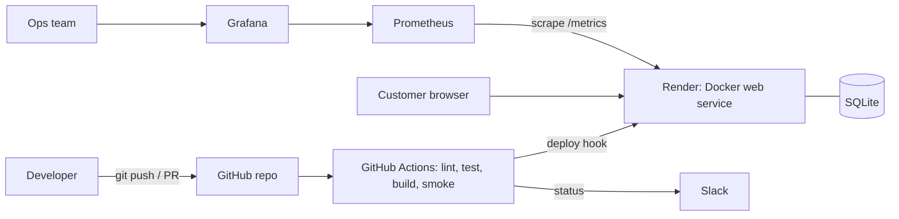

# Architecture and DevOps Workflow (report support notes)

## 1. MVT mapping

| Layer | Implementation | Why it addresses the monolith's problems |
|---|---|---|
| Model | `store/models.py` (Category, Product, Order, OrderItem) | Data rules live in one place; schema changes ship as migrations, not manual SQL |
| View | `store/views.py`, `store/cart.py`, `store/forms.py` | Small single-purpose functions; cart logic isolated and unit-tested |
| Template | `store/templates/store/*.html` + `static/` | Front-end changes do not touch business logic |

Modularity: `cart.py`, `forms.py`, `context_processors.py` and `management/commands/` are separate modules; new features
(e.g. payments, reviews) can be added as new Django apps without editing existing ones.

## 2. Architecture diagram (Mermaid - paste into draw.io via Arrange > Insert > Advanced > Mermaid)

## 3. Wireframes (describe or redraw in draw.io)

- **Catalogue:** header (logo, search, login, basket badge) / category bar / hero / 4-column product card grid / pager.
- **Product detail:** large image left; name, price, stock, quantity, "Add to basket" right.
- **Basket:** table (product, price, qty with update, total, remove), subtotal, Continue / Checkout buttons.
- **Checkout:** address form left, order summary right.

## 4. Pipeline stages (workflow plan for section c of the report)

| Stage | Tool | Gate |
|---|---|---|
| Plan | Trello/GitHub Issues, draw.io | Backlog items linked to PRs |
| Code and commit | Git, GitHub, branch strategy, VS Code | PR review required |
| Build | Docker (multi-step, cached layers, non-root user) | Image must build |
| Test | Django test runner, coverage | All tests pass, coverage >= 80%, flake8 clean, no missing migrations |
| Release/Deploy | GitHub Actions to Render deploy hook | Only `main`, only after smoke test |
| Operate/Monitor | Prometheus, Grafana, `/health/`, container logs | Alert rules in `monitoring/alerts.yml` |
| Feedback | Slack notifications, GitHub Issues | Failed runs notify the team |

## 5. Team and culture (for the collaboration section)

Suggested PoC team: product owner, 2 developers, 1 DevOps/platform engineer, 1 QA. Culture: shared ownership
("you build it, you run it"), blameless post-mortems, small frequent changes, trunk-style short-lived branches,
infrastructure as code reviewed like application code, shared dashboards visible to both dev and ops.

## 6. Known limitations (for the critical evaluation)

- SQLite is single-writer and ephemeral on Render's free tier; use PostgreSQL in production.
- Payment is simulated; a real gateway (e.g. Stripe) and PCI considerations are out of scope.
- Free-tier cold starts; no blue/green or canary deployment; Prometheus/Grafana run locally in Docker Compose, not on Render.
- End-to-end tests use Django's test client rather than a real browser; Playwright/Selenium would be the next step.
- Secrets are handled with environment variables and GitHub Secrets; a vault would be used at scale.
